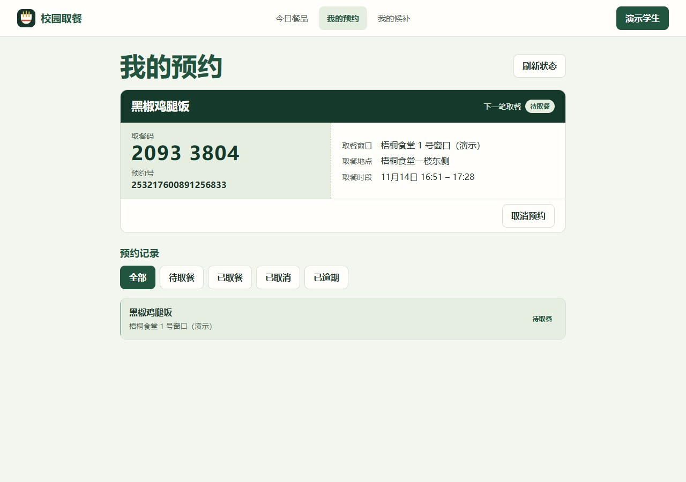
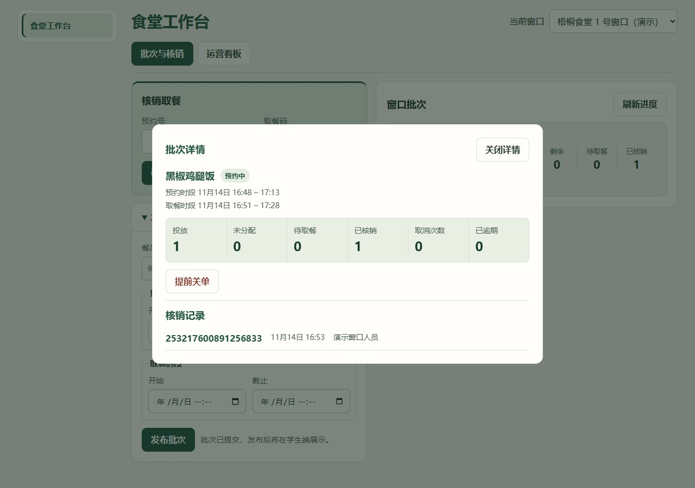

# 校园餐饮余量预约与到店核销平台

## Project Overview

「校园取餐」面向学生和食堂窗口。学生免费预约当天的余量餐，按取餐时段到窗口出示取餐码。窗口人员在工作台发布批次、查看余量和核销进度。

## Docker 本地演示

安装 Docker 和 Compose v2 后，在仓库根目录执行以下命令。首次启动会下载镜像、构建应用并初始化演示数据。

```bash
docker compose -f compose.demo.yml up --build -d --wait
```

打开 [校园取餐登录页](http://127.0.0.1:8081/login.html)。填写对应手机号，点击「获取验证码」，用页面显示的验证码登录。

| 角色 | 演示手机号 | 登录入口 |
| --- | --- | --- |
| 窗口人员 | `19900009002` | 商家 / 管理员登录 |
| 学生 | `19900009003` | 学生登录 |
| 管理员 | `19900009001` | 商家 / 管理员登录 |

1. **发布**。窗口人员进入「食堂工作台」，为「梧桐食堂 1 号窗口（演示）」发布一份「黑椒鸡腿饭」，库存填 `1`。预约开始和取餐开始设为刚过去几分钟，预约截止设为至少 15 分钟后，取餐截止设为至少 30 分钟后。时间使用北京时间，预约开始须早于取餐开始。
2. **预约**。保留工作台，在新标签页用学生账号登录。打开「今日餐品」预约，再到「我的预约」查看预约号和 8 位取餐码。刚发布的批次可能需要几秒才可预约，刷新页面即可查看。
3. **核销**。回到工作台，填写预约号和取餐码并提交。学生刷新预约详情可看到「已取餐」，工作台的已核销数量加一。

管理员可在「窗口与人员」查看演示窗口和预置的人员绑定。三个账号和窗口均为虚构演示数据。
演示版只监听本机，使用独立的 Compose 项目和数据卷。页面显示验证码的配置仅用于本机演示。
如果 8081 端口已被占用，可在执行启动命令前将 `FOODIEGO_DEMO_PORT` 环境变量设为其他端口，再用该端口打开登录页。

```bash
docker compose -f compose.demo.yml down
```

停止后仍保留演示数据。如需从头演示，可执行 `docker compose -f compose.demo.yml down -v` 清空这个演示环境的数据卷，再重新启动。

<details>
<summary>查看学生预约与窗口核销截图</summary>





</details>

## Tech Stack

- **Language**: Java 17
- **Framework**: Spring Boot 2.x
- **Database**: MySQL 8.0+
- **Cache**: Redis 6.x + Redisson
- **Message Queue**: RabbitMQ
- **ORM**: MyBatis Plus
- **API Docs**: Swagger

## Project Structure

```
src/main/java/com/foodiego/
├── FoodieGoApplication.java       # Application entry point
├── controller/                    # REST controllers
│   ├── UserController.java        # 登录和当前账号
│   └── MealReservationController.java # 餐品、预约和食堂工作台
├── service/                       # Business service layer
├── mapper/                        # Data access layer
├── entity/                        # Entity classes
├── dto/                           # Data transfer objects
├── config/                        # Configuration classes
└── utils/                         # Utility classes
```

## Quick Start

### Windows 一键启动和停止

前端静态资源位于 `src/main/resources/static/`，由 Spring Boot 同源提供；启动后端后访问
`http://localhost:8081/` 即可，无需单独启动 Nginx。

在项目根目录双击 `start.bat` 启动 MySQL、Redis 和 FoodieGo。双击 `stop.bat` 停止本次启动记录中的进程。脚本使用本机已安装的 JDK 17、Maven 和各项服务，运行路径记录在 `scripts/FoodieGo.ps1`。

项目 MySQL 使用 3307 端口和 `.local-services/mysql/data` 数据目录。该目录需先初始化并导入 `src/main/resources/db/hmdp.sql`，已有库按下文执行缺少的迁移。脚本在缺少 JAR 或源码更新时自动构建，使用 `dev` 配置启动，只监听本机。进程记录和日志位于 `.local-services/launcher/`。

FoodieGo 共用本机的 `RabbitMQ` Windows 服务（`127.0.0.1:5672`）。请在运行 `start.bat` 前确认该服务已启动；`stop.bat` 会让共享服务继续运行。RabbitMQ 账号沿用 `application.yaml` 的配置，也可通过 `RABBITMQ_USER` 和 `RABBITMQ_PASSWORD` 环境变量覆盖。

### Prerequisites

- JDK 17
- Maven 3.6+
- MySQL 5.7+
- Redis 6.x+
- RabbitMQ 3.8+

### Configuration

1. Create the database and run the init script:

```sql
CREATE DATABASE foodiego CHARACTER SET utf8mb4 COLLATE utf8mb4_unicode_ci;
```

Execute `src/main/resources/db/hmdp.sql`

2. Update database, Redis, and RabbitMQ connection settings in `src/main/resources/application.yaml`

### Running the Application

**Development mode:**

```bash
mvn spring-boot:run
```

**Build & package:**

```bash
mvn clean package
java -jar target/foodiego-0.0.1-SNAPSHOT.jar
```

**Docker deployment:**

```bash
mvn clean package -DskipTests
docker compose up -d
```

Docker builds the packaged JAR. MySQL imports `db/hmdp.sql` only when the database
volume is empty; existing volumes are preserved.

## Core Features

| Module | Feature | Description |
|--------|---------|-------------|
| 学生 | 今日餐品 | 浏览取餐窗口、余量、预约截止和取餐时段 |
| 学生 | 我的预约 | 查询处理状态、查看取餐码、在预约截止前取消 |
| 窗口人员 | 食堂工作台 | 发布批次、查看剩余/待取餐/已核销份数、核销取餐 |
| 管理员 | 窗口与人员 | 新增食堂窗口、按注册手机号绑定人员、解除窗口绑定 |

## API Documentation

启动后打开 `http://localhost:8081/swagger-ui.html` 查看校园接口。需要运行历史接口回归测试时，可以显式启用 Spring 的 `legacy` profile。

## Key Features

- Redis Lua 原子预扣余量并写入待投递记录，RabbitMQ 异步确认预约。
- MySQL 唯一索引约束同一账号每批只能预约一份。取消与核销用订单状态条件更新决定哪次操作成功。
- 窗口发布、查询和核销均校验人员与窗口的绑定关系。

## 正确性修复与部署说明（2026-10-25）

- 预约、预约查询、取消和窗口操作需要 `Authorization: <token>`。今日餐品、静态页面和 `/actuator/health` 可直接访问。
- 启用 `legacy` 时，新增/修改商铺、创建优惠券、删除上传图片需要管理员身份。通过
  `FOODIEGO_ADMIN_USER_IDS=1,2` 配置已有用户 ID；默认为空，拒绝所有管理写操作。
  这是当前单体项目的管理员白名单，不包含商家资源归属模型。
- 请求开始时清除残留用户上下文，请求完成（包括异常和权限拒绝）后清理，防止线程复用串号。
- 秒杀时间按 `FOODIEGO_SECKILL_ZONE_ID` 解释，默认 `Asia/Shanghai`；
  Lua 使用 Redis 时钟判断 `[开始时间, 结束时间)`。数据库提交后才原子发布库存和时间元数据，
  保留到活动结束后一天。缺少元数据或库存时拒绝抢购，不自动重建库存。
- 消费者在数据库事务内锁定活动记录、检查订单，再扣库存并保存；保存失败回滚库存。
  唯一索引约定同一用户、同一优惠券最多一笔订单，取消后重购不在本次实现范围内。
- 消费失败最多执行四次（首次加三次退避重试），之后进入死信队列。
  死信先提交数据库失败记录，再通过 Lua 幂等回补；成功订单不会回补，
  迟到的失败订单消息不会重新创建订单。补偿失败保留消息并重试。
- 秒杀 Lua 脚本会把预扣成功的订单原子写入 Redis outbox；发布器将消息先移入
  processing 列表，收到 RabbitMQ 发布确认后才删除。进程中断或发布失败的记录会保留，
  由定时任务继续投递。
- 登录验证码不再输出到日志或接口响应。开发环境 `dev` profile 可通过
  `FOODIEGO_EXPOSE_LOGIN_CODE=true` 临时显示验证码，任何共享/生产环境均不得启用；
  同一手机号的发送间隔为 60 秒。
- Redisson 与 Spring Redis 共用连接配置。Compose 为 Redis 配置密码、AOF 和数据卷，
  为上传目录配置持久卷。开发模式上传目录为 `./uploads`，可用
  `FOODIEGO_UPLOAD_DIR` 覆盖，图片通过 `/imgs/**` 访问。

### 已有数据库升级

1. 暂停抢购入口并等待已接受的订单消费完毕。
2. 备份数据库，先检查重复的 `(user_id, voucher_id)`：
   `src/main/resources/db/migrations/20261019_order_idempotency.sql` 开头包含检查 SQL。
3. 根据业务记录处理重复数据后，在旧库执行该增量脚本一次，添加唯一索引和失败记录表。
   不要对已有数据库重新执行包含 `DROP TABLE` 的 `hmdp.sql`。
4. 配置管理员 ID 后启动新版本。旧的正在进行的活动若缺少
   `seckill:info:<券ID>` 元数据会拒绝抢购；需要从数据库活动时间补充
   `begin_time`、`end_time`（上述时区对应的 Unix 毫秒），不要重置已售活动的库存。
   新建活动会自动发布这些数据。

若数据库已提交但 Redis 发布失败，创建接口会报错，活动保持不可抢购，需要排查 Redis
后补充活动缓存。已有库还需在验证重复关注数据后执行
`src/main/resources/db/migrations/20261025_social_indexes.sql` 一次，为关注、点赞和查询补齐约束与索引。

### 回归验证

使用 JDK 17 运行默认单元测试：

```bash
mvn test
```

Lua 测试连接本机独立的 Redis 测试实例，通过环境变量指定端口，不清空共享数据库：

```bash
FOODIEGO_TEST_REDIS_PORT=16381 mvn test -Dtest=SeckillLuaTest
```

有 Docker 时可执行 MySQL、Redis 和 RabbitMQ 的完整集成测试：

```bash
mvn test -Pintegration-test -Dtest=LoginIntegrationTest,ShopCacheIntegrationTest,SeckillIntegrationTest
```

秒杀集成测试同时核对 Redis 库存、异步落库订单数和 MySQL 库存。H2 测试不能替代
MySQL 的实际隔离级别与锁行为验证；部署前仍应在目标基础设施上执行集成测试。

## 校园余量餐演示

1. 已有数据库在停止应用后，按顺序执行尚未应用的 `src/main/resources/db/migrations/20261111_meal_reservations.sql` 和 `src/main/resources/db/migrations/20261113_meal_operations.sql`。新数据库使用 `db/hmdp.sql` 初始化。
2. 启动前设置 `FOODIEGO_ADMIN_USER_IDS` 为已有管理员账号的用户 ID，多个 ID 以逗号分隔。使用本机 `start.bat` 时，也可把用户 ID 写入项目下的 `.local-services/launcher/admin-user-ids.txt`。环境变量优先，默认没有管理员。
3. 打开 `http://localhost:8081/login.html`，选择「商家 / 管理员登录」。管理员在「窗口与人员」新增或选择食堂窗口，再用窗口人员的注册手机号绑定账号。窗口人员使用同一入口登录后，在「食堂工作台」发布和核销。管理员账号也绑定了窗口时，后台会显示两项功能。
4. 学生在登录页选择「学生登录」，登录后在学生端预约，在「我的预约」查看预约号和 8 位取餐码。学生端和后台可以在同一个浏览器里分别登录。窗口人员核销后，学生页面显示「已取餐」，工作台的待取餐数减一、已核销数加一。演示取消与核销竞争时，设置有重叠的预约时段和取餐时段。

批次发布和取消回补由后台任务执行。`FOODIEGO_OUTBOX_POLL_MS` 控制轮询间隔，默认为 `1000` 毫秒。预约截止前可以取消，回补的余量供其他账号预约。同一账号同一批次保留一笔成功预约记录。取餐截止后，未核销的预约显示「取餐已截止」。

「我的预约」支持状态筛选、分页和下一笔取餐。工作人员在 `/backoffice.html` 的批次详情查看核销记录、提前关单，或切换到运营看板按窗口和取餐日期查询。关单以 Redis 停止接单为准，已受理的预约可继续落单、取餐或在原预约截止前取消。取餐截止后，定时任务将仍待取餐的预约更新为逾期，不回补库存。取消次数按订单计，同一份回补后可再次分配。取餐率 = 已核销 ÷（已核销 + 已逾期）。

学生端可以按菜名、窗口和预约状态组合筛选。公开接口 `GET /meal-batches` 接受 `q`、`windowId`、`status`（`OPEN`、`SCHEDULED`、`SOLD_OUT`）和 `today`（仅看今日取餐）参数，最多返回 50 个匹配批次。`GET /campus-windows` 返回今日有批次的窗口，`GET /campus-windows/{windowId}` 返回取餐地址和未截止的公开批次。

售罄后可加入候补，并在「我的候补」查看排位、确认名额或退出。回补余量优先分给候补，确认期默认 5 分钟且不超过批次预约截止时间。退出或超时会释放名额给下一位。确认后沿用原预约、取餐码与核销流程。候补排队和临时名额保存在 Redis，建议启用 AOF。确认期可用 `FOODIEGO_MEALS_WAITLIST_HOLD_MS` 调整。

候补接口包括 `POST /meal-batches/{batchId}/waitlist`、`GET /meal-waitlist`、`POST /meal-waitlist/{batchId}/confirm` 和 `POST /meal-waitlist/{batchId}/leave`。确认与退出请求带上当轮候补的 `attempt`，防止过期操作影响重新排队。重复确认同一轮候补会返回同一预约号。

有 Docker 的环境可运行余量餐集成测试，覆盖并发抢订、预约归属和取消与核销的竞争。

```bash
mvn test -Pintegration-test -Dtest=MealReservationIntegrationTest
```
